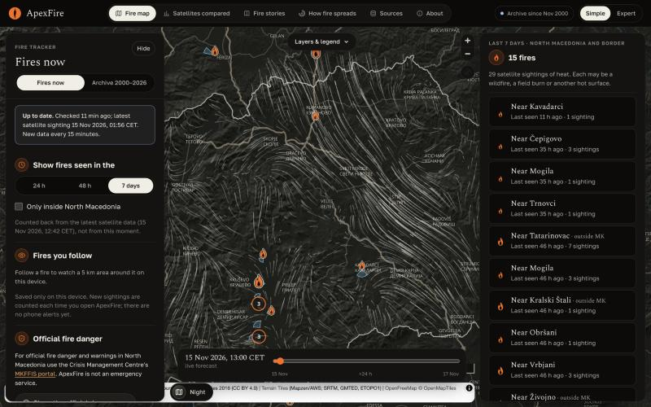
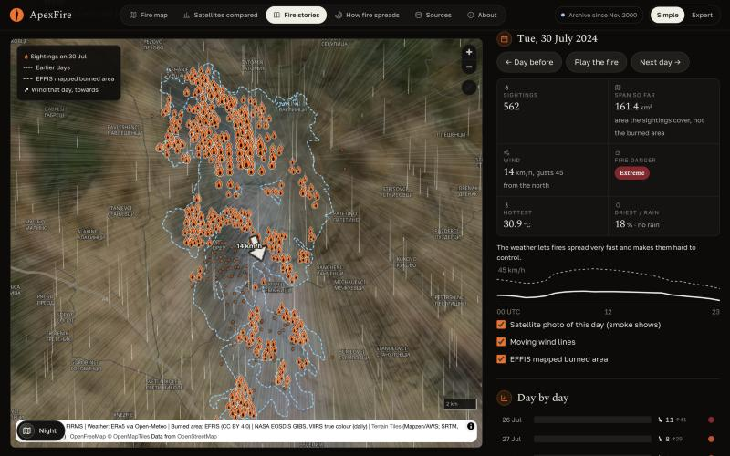
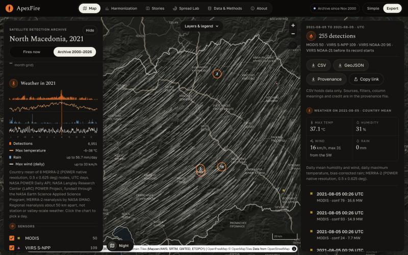
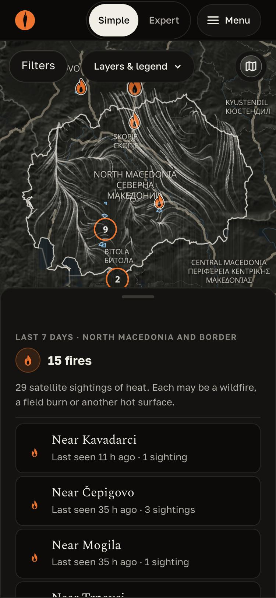
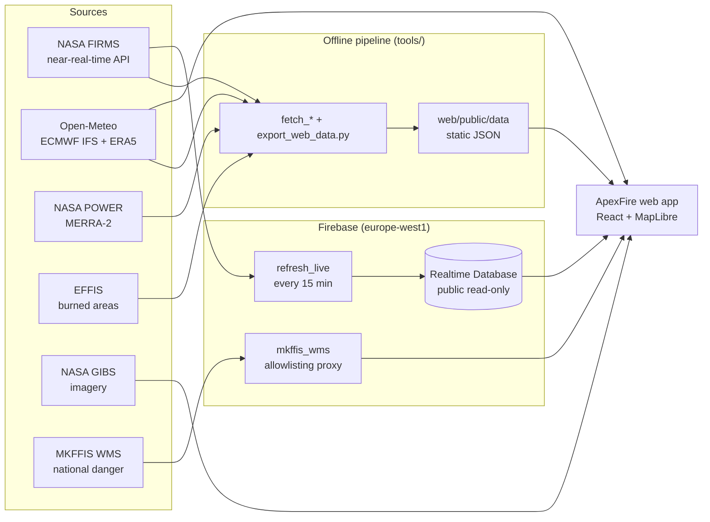

<p align="center">
  
</p>

<h1 align="center">ApexFire</h1>

<p align="center"><strong>North Macedonia's fire tracker and fire evidence archive.</strong><br>
Live satellite fire detections, wind and fire danger for everyone; every detection since 2000, tested sensor harmonization and day-by-day fire case studies for experts.</p>

<p align="center"><a href="https://apexfire.web.app"><strong>Open ApexFire → apexfire.web.app</strong></a></p>

<p align="center">
  <a href="LICENSE"></a>
  
  
</p>

> [!IMPORTANT]
> ApexFire is a research prototype, **not an emergency service**. A satellite detection is a hot pixel seen on one pass, not a confirmed fire, and clouds or timing can hide real fires. For official fire danger and warnings in North Macedonia use the Crisis Management Centre's [MKFFIS](https://mkffis.cuk.gov.mk/index.php/pocetna_strana/pocetna?lang=en) and call 112 / 193 in an emergency.



## Why ApexFire

Fire information for North Macedonia is scattered: global satellite maps, the European EFFIS viewer, the national MKFFIS portal and news reports each show one piece, mostly in English and mostly for specialists. ApexFire puts the pieces on one map for two audiences:

- **Everyday users** see where satellites see heat right now, how close it is to their town, where the wind carries smoke and how dangerous the weather is, in plain language (**Simple** mode).
- **Experts** (researchers, journalists, agencies) get the full 2000–2026 national record with native confidence values, filters, provenance-stamped exports, a tested MODIS–VIIRS harmonization and evidence-backed case studies (**Expert** mode).

A [competitive review](docs/research/competitive-review-2026-11-15.md) of nine wildfire maps found no other product that combines both for this country.

## Features

### For everyone

| | |
| --- | --- |
| **Fires now** | NASA FIRMS near-real-time detections (VIIRS NOAA-20/21, MODIS), refreshed every 15 minutes by a scheduled cloud function and grouped into fires named after the nearest settlement, with settlements within 5 km. |
| **Wind** | ECMWF IFS 10 m wind drawn as moving streaks, sampled every 0.125° (close to the 9 km model) so valleys and ridges the model resolves stay visible; 48 h forecast slider; per-fire "where smoke would drift" sectors. |
| **Fire danger** | Canadian Fire Weather Index (the system EFFIS uses) computed in the browser for any point you tap, today plus two days, with EFFIS danger classes. The national MKFFIS daily danger and vegetation-dryness maps can be overlaid (see [MKFFIS](#mkffis-national-layers)). |
| **Locate me** | One tap shows your position and the fires around it. The position stays in your browser. |
| **Follow and share** | Follow a fire to watch a 5 km area on this device; share links open the same view. |
| **Satellite photo** | NASA GIBS true-colour image of a fire's day, where smoke plumes show. |
| **Simple / Expert** | Plain words, flame markers and icon headings in Simple; sensor shapes, native values and exports in Expert. Phone layout with a draggable results sheet. |

### For experts

| | |
| --- | --- |
| **Archive 2000–2026** | 97,785 detections over North Macedonia from MODIS, VIIRS S-NPP, NOAA-20 and NOAA-21, each kept as its own sensor; calendar, date range, sensor, native-confidence and algorithm-label filters; coverage matrix that marks gaps instead of drawing zero. |
| **Exports with provenance** | CSV (data only), GeoJSON and a provenance JSON (sources, file hashes, filters, column meanings, credit) for any filtered view. |
| **MODIS–VIIRS harmonization** | Fire-active cell-days converted between sensor generations with held-out tests (NOAA-20 → MODIS R² 0.90 on held-out months, 6.9 % annual error), so the 2000s and 2020s can be read on one scale. The [method](web/src/pages/Harmonization.tsx) and limits are on the page. |
| **Weather for every archive day** | NASA POWER (MERRA-2) daily weather 2000–2025: a year chart aligning detections with heat, rain and wind, the chosen day's country-mean weather and its mean wind field on the map. |
| **Fire stories** | 14 real fires: 12 officially mapped by EFFIS (2016–2025) with every detection inside the perimeter by day, ERA5 hourly wind and weather, the Fire Weather Index, land cover and the satellite image of each day; plus two in-depth case studies (Brvenica 2017 observed progression; Mariovo 2024 evidence study). |
| **Landscape** | What burns in North Macedonia: fire starts by land type and month (MODIS 2001–2025, VIIRS 2012–2025), burned area by land type from NASA MCD64A1 (2001–2025) and EFFIS (2016 to now), which land burns more than its share, fire size and duration; land-cover and burned-area map layers. |
| **Spread Lab** | 419 precomputed, clearly labelled experimental surface-fire runs (Pyretechnics) on the real Mariovo landscape: choose start, wind speed and direction, and dryness; replay real ERA5 afternoons; and compare the model with two mapped fires (Negotino 2022, Makedonski Brod 2019: covers 88–99 % of each burn, ends 3–9× too large). Uncalibrated, not a forecast. |
| **Data & Methods** | Every source, transformation and interpretation rule, with what was verified and what was not. |

| Fire story (Sveti Nikole, 30 July 2024) | Archive, Expert mode (5 August 2021) |
| --- | --- |
|  |  |

<p align="center"></p>

## How it works



- **Web app** (`web/`): React 19, TypeScript, Vite 8 and MapLibre GL JS 6, plain CSS tokens; no tracking, accounts or cookies. Basemaps from OpenFreeMap (Night, Light, Terrain) or the EOX Sentinel-2 cloudless mosaic, with Terrain Tiles relief.
- **Live feed** (`functions/main.py`): a Python Cloud Function fetches FIRMS with a key kept in Secret Manager, groups detections into fires and writes one validated snapshot; a failed run never erases the last good one, and the site marks data stale after 30 minutes.
- **Static data** (`tools/` → `web/public/data/`): the national archive partitions, harmonization, weather years and fire stories are generated offline with hashes and provenance, so the site needs no database for history.
- **Browser-side science**: the Fire Weather Index (`web/src/lib/fwi.ts`) and wind fields (`web/src/lib/wind-field.ts`) are computed in the browser from model data.

## Getting started

Requirements: Node.js 22 or newer (developed on 24), npm; Python 3.12+ only for the data tools and cloud function.

```bash
cd web
npm ci
npm run dev        # http://localhost:5173
```

```bash
npm test           # vitest
npm run build      # type-check, production build, public-boundary and secret check
npm run preview    # production build at http://localhost:4173
```

The repository includes the generated public data (`web/public/data`, about 19 MB), so the site runs without the raw archive. The live feed is read from the project's public Realtime Database by default.

| Build-time variable | Purpose | Default |
| --- | --- | --- |
| `VITE_LIVE_URL` | Realtime Database root for the live detection feed; empty turns it off (saved sample shown, labelled) | the ApexFire database |
| `VITE_MKFFIS_WMS` | MKFFIS WMS proxy path or URL; empty hides the national layers | `/mkffis/wms` |
| `VITE_SITE_URL` | Absolute site address for link previews (Open Graph) | `https://apexfire.web.app` |

### Data pipeline

```bash
python3 -m venv .venv && .venv/bin/pip install -r tools/requirements.txt
python3 tools/fetch_power_weather.py           # NASA POWER daily weather 2000–2025 (no key)
python3 tools/fetch_fire_stories.py            # EFFIS perimeters + ERA5 for tools/fire_stories.json (no key)
.venv/bin/python tools/fetch_landscape.py      # CORINE 2000–2018 + EFFIS burned areas (no key)
uv run --python 3.14 tools/fetch_mcd64a1.py    # NASA MCD64A1 2001–2025 (Earthdata bearer)
python3 tools/fetch_firms_archive.py           # FIRMS API gap years (needs a free FIRMS MAP_KEY, kept out of the repo)
$SPREAD_PY tools/run_spread_lab.py --fetch      # Spread Lab runs; $SPREAD_PY = Python 3.11 env from tools/spread-requirements.txt
.venv/bin/python tools/export_web_data.py      # regenerate web/public/data
.venv/bin/python -m unittest discover -s tests -p test_export_web_data.py   # export contracts and hashes
functions/venv/bin/python -m unittest tests/test_functions.py               # ingestion and MKFFIS proxy
```

The original FIRMS archive (7,263 CSV files, 24 GB, of which 47,046 rows are in North Macedonia) is **not** in this repository; it lives in a local `Data/` folder. The export re-verifies its hashes and row counts, and the processed result is committed. [docs/data-audit](docs/data-audit) and [docs/readiness](docs/readiness/README.md) record how every source was obtained and checked.

### Cloud (Firebase)

Project `firewatch-ff023` (the Firebase name predates the ApexFire rename and is kept so nothing deployed breaks).

| Component | State |
| --- | --- |
| `refresh_live` scheduled function + Realtime Database rules | Deployed (europe-west1); clients can read, not write |
| `mkffis_wms` allowlisting proxy + Hosting rewrite `/mkffis/wms` | Built and emulator-tested, **not deployed** (MKFFIS reuse terms unconfirmed) |
| Hosting (`web/dist`, site `apexfire`) | Published at [apexfire.web.app](https://apexfire.web.app), built with `VITE_MKFFIS_WMS=` so the national layers stay off until the proxy is deployed |

```bash
tools/go_live.sh                                   # ingestion function + rules (asks first; reads the key privately)
firebase emulators:start --only hosting,functions  # local check of rewrites and the proxy
(cd web && VITE_MKFFIS_WMS= npm run build) && firebase deploy --only hosting   # publish the site (functions and rules untouched)
```

## MKFFIS national layers

MKFFIS publishes daily Fire Weather Index maps (since 2012) and 8-day vegetation-dryness maps over WMS. The service is HTTP-only without CORS, so the browser reaches it through a same-origin proxy: Vite's proxy locally, and the `mkffis_wms` function in production, which accepts only GetMap and GetLegendGraphic of those layers over North Macedonia, rebuilds every request and relays only real PNG images. **Reuse terms are not yet confirmed with the Crisis Management Centre; the production proxy will not be deployed until they are.**

## Project structure

```
web/                 React + TypeScript app (src/pages, src/components, src/lib), public data, build checks
functions/           Firebase Cloud Functions: live ingestion, MKFFIS proxy
tools/               Data acquisition, export, harmonization and model scripts (Python)
tests/               Python tests for exports, ingestion, proxy and analyses
docs/                Specification, data audit, readiness evidence, research, case studies, screenshots
logo/                Brand assets (SVG masters, PNG renders, kit)
```

## Limits

- Detections are hot pixels, not fires; their size reflects radiative power, not burned area. First detection is not ignition time.
- Sensor counts differ by generation; raw counts across 2012 and 2018 are not comparable without the harmonization.
- Weather is from models and reanalysis (ECMWF IFS, ERA5, MERRA-2), not stations; MERRA-2 daily values are about 50 km apart.
- Fire stories align detections with EFFIS perimeters within a 1.5 km margin; EFFIS and satellite timelines can differ.
- The spread demonstration is one uncalibrated model run, not a prediction.
- Not tested on every device; drag behaviour on iOS Safari has not been verified on hardware.

## Roadmap

From the [competitive review](docs/research/competitive-review-2026-11-15.md): alerts that reach users (web push for followed fires and places), an installable app, a Macedonian interface, all EFFIS burned areas as a map layer, EFFIS fire-danger forecast maps for the coming days, documented open data downloads, statistics by region, and a printable fire report. Scientific next steps include validated spread modelling and faster sensors.

## Data sources and licences

| Source | Used for | Terms |
| --- | --- | --- |
| [NASA FIRMS](https://firms.modaps.eosdis.nasa.gov/) (MODIS C6.1, VIIRS 375 m) | Live and archive detections | NASA open data; cite LANCE/FIRMS |
| [EFFIS](https://forest-fire.emergency.copernicus.eu/) (European Commission JRC) | Burned-area perimeters, season statistics | CC BY 4.0 |
| [CORINE Land Cover](https://land.copernicus.eu/en/products/corine-land-cover) 2000–2018 (EEA) | Landscape land cover | © EU, Copernicus Land Monitoring Service; attribution |
| [NASA MCD64A1](https://lpdaac.usgs.gov/products/mcd64a1v061/) v061 | Burned area 2001–2025 | NASA open data |
| [Open-Meteo](https://open-meteo.com/): ECMWF IFS, ERA5 (Copernicus C3S) | Live wind and weather, fire-story weather, Fire Weather Index inputs | CC BY 4.0 |
| [NASA POWER](https://power.larc.nasa.gov/) (MERRA-2, NASA GMAO) | Daily archive weather 2000–2025 | NASA open data |
| [NASA GIBS](https://nasa-gibs.github.io/gibs-api-docs/) | Daily true-colour imagery | NASA open data |
| [MKFFIS](https://mkffis.cuk.gov.mk/) (Crisis Management Centre) | National danger and dryness maps (live, proxied) | Unconfirmed; see above |
| [FireSpread_MedEU v2](https://zenodo.org/records/18200075) | Brvenica 2017 observed progression | CC BY 4.0 |
| [CAMS](https://atmosphere.copernicus.eu/) via Open-Meteo | Live air quality for Skopje (Expert) | Copernicus licence |
| [geoBoundaries](https://www.geoboundaries.org/) 2016, [GeoNames](https://www.geonames.org/) | Country outline, places and settlements | CC BY 4.0 |
| [OpenFreeMap](https://openfreemap.org/) / [OpenStreetMap](https://www.openstreetmap.org/copyright) | Basemaps | ODbL (data) |
| [Terrain Tiles](https://github.com/tilezen/joerd/blob/master/docs/attribution.md) | Relief shading | SRTM, GMTED, ETOPO1 attributions |
| [Sentinel-2 cloudless 2024](https://s2maps.eu) by EOX | Satellite basemap | CC BY-NC-SA 4.0 (non-commercial) |
| Pyretechnics | Spread Lab model output | Its own licence: `web/public/data/spread/PYRETECHNICS-LICENSE.txt` |
| Golos Text, Spectral | Typefaces | SIL Open Font License |

## Licence

The ApexFire source code is released under the [MIT licence](LICENSE). Data, imagery and fonts remain under their providers' terms listed above.

## Acknowledgements

Built for the NASA Space Apps Challenge 2026 ("Harmonization of MODIS and VIIRS Hot Spots"), with gratitude to the NASA FIRMS, LANCE, POWER and GIBS teams, the European Forest Fire Information System, ECMWF and Copernicus, Open-Meteo, and North Macedonia's Crisis Management Centre.
