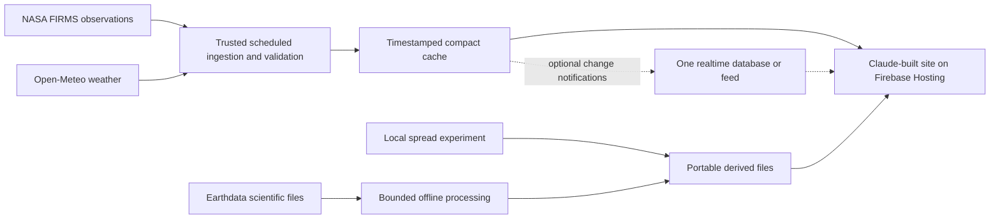

# FIRMS, Firebase and Google Cloud preparation

Checked 14 November 2026. Status: **keyed NASA feeds and read-only cloud access verified; no cloud ingestion service or database deployed**. No website was built.

## Actual FIRMS proof

`python3 tools/check_firms.py` reads the user's local credential file internally and sends the MAP_KEY only to NASA FIRMS. Keys, headers and credential-bearing URLs are not printed or saved. The source file is owner-readable/writable and excluded by `.gitignore`.

Two bounded one-day requests for **20.4–23.1°E, 40.8–42.5°N** returned HTTP 200 and valid CSV:

| Source | Detections | Latest acquisition UTC | Interpretation |
| --- | ---: | --- | --- |
| VIIRS NOAA-20 NRT | 3 | 14 Nov 2026 00:32 | Satellite observations in the requested rectangle |
| VIIRS NOAA-21 NRT | 1 | 14 Nov 2026 01:13 | Satellite observations in the requested rectangle |

The rectangle includes neighboring territory. These are not four confirmed Macedonian wildfires or proof that the pixels are still burning. At retrieval the newest observation in each returned series was approximately 18.3 / 17.6 hours old. That is **age of the returned detections**, not measured satellite-to-FIRMS delivery latency or proof of a stale feed. Observation and retrieval timestamps must be displayed separately.

The parser checks required columns, numeric finiteness, coordinate bounds, requested bbox, dates, valid HHMM minutes, native VIIRS confidence categories, nonnegative FRP and future acquisition times. An HTTP-200 text error is rejected as an invalid CSV schema; a valid header-only response is accepted as zero returned detections. Raw confidence and every raw column are preserved; this proof does not impose a wildfire/industry or confidence-filtering policy.

Evidence: [manifest](../../Data/readiness/firms/manifest.json), original CSVs and normalized JSON beside it. Raw bytes have SHA-256 recorded. [Tests](../../tests/test_check_firms.py) passed for UTC leading-zero times, low-confidence retention, invalid/body-level error rejection and valid empty responses. This is access/parser verification, not operational detection validation.

Source/API contract: [NASA Area API](https://firms.modaps.eosdis.nasa.gov/api/area/), [FIRMS API guidance](https://firms.modaps.eosdis.nasa.gov/content/academy/data_api/firms_api_use.html). The currently documented area request permits 1–5 days; this proof uses one day. Satellite overpasses, cloud/sensitivity and publication delay remain constraints even if a downstream database updates instantly.

## Actual Firebase and Cloud state

Read-only Firebase CLI 15.36.0 and existing Google Application Default Credentials were used. A Firebase CLI update-check permission error was resolved by disabling its optional update notifier; no ownership/permission changes to global configuration were made.

| Item | Observed state |
| --- | --- |
| Firebase project `firewatch-ff023` | ACTIVE; display name ApexFire |
| Registered web app | Present; app ID matches the configuration supplied by the user |
| Hosting site | Registered as `firewatch-ff023`; deployment/content not tested |
| Local initialization | No `firebase.json`, `.firebaserc`, Firebase rules or app package found in this folder at inspection |
| Realtime Database | Firebase's read-only instance list succeeded and returned **zero instances** |
| Firestore | Listing blocked: its API has not been used or is disabled; no database existence claim made from that 403 |
| Firebase-project billing | Cloud Billing metadata says **billingEnabled=false** |
| Enabled relevant APIs in Firebase project | Hosting, Storage and BigQuery; enabled API does not prove bucket/database/data existence |
| Configured gcloud project | A **different** research project; active, billingEnabled=true; 53 enabled APIs |
| gcloud CLI account | No active CLI account; project-description command blocked through that route |
| Existing ADC | Token obtained privately; authenticated project, billing-status and enabled-service metadata reads succeeded for both projects |
| Earth Engine, Cloud Run, Scheduler, Secret Manager | Not among enabled services in either inspected project |
| $300 credit balance/expiry | Not checked; do not assume the Firebase project shares the research project's billing/credits |
| Changes made remotely | None: no APIs enabled, jobs/databases created, data uploaded, billing linked or deployment performed |

Evidence: [sanitized Cloud metadata](../../Data/readiness/cloud/project-state.json), [Firebase CLI checks](../../Data/readiness/cloud/firebase-state.json). ADC and Firebase CLI account authentication are distinct mechanisms. CLI-account absence did not prevent the ADC read-only checks. Credit eligibility, remaining balance and expiry need account-specific billing evidence before spending decisions.

Computer use refused access to the Terminal application. The existing interactive `firebase init` prompt therefore remains uninspected. The supported CLI/file checks above establish remote app registration and local-file absence; they do not claim that the open initializer completed.

## What Firebase and Google Cloud actually add

**Firebase is a distribution/application platform, not a satellite or weather source.** Realtime Database synchronizes data that our process writes; it cannot detect a fire or remove satellite overpass/publication delays. The supplied `initializeApp` creates a client SDK instance. `getAnalytics` initializes usage analytics; neither imports wildfire observations nor creates a realtime database. [Realtime Database](https://firebase.google.com/docs/database), [web setup](https://firebase.google.com/docs/web/setup), [Analytics setup](https://firebase.google.com/docs/analytics/get-started?platform=web).

**Recommendation for Claude's eventual build:** use the existing Firebase Hosting site if it fits the selected frontend. Start with compact portable data files and a server-side/shared cache. Add a managed ingestion job only for a measured refresh requirement, and add one realtime distribution channel if client push updates materially improve the demo. Do not adopt both Firestore and Realtime Database by default, or load the 24 GB raw archive into either.

The cloud role would be scheduled ingestion/hosting/sharing, not an improvement in underlying satellite or weather accuracy. Cloud Run/Functions plus a scheduler can fetch once for all visitors, keep NASA credentials out of the client and preserve last successful data during an outage. This requires a deliberate project/billing/region choice, required APIs and least-privilege setup. Those changes are not prerequisites to rendering the verified local evidence and were not made during preparation. [Scheduled functions](https://firebase.google.com/docs/functions/schedule-functions), [pricing](https://firebase.google.com/pricing).

Google Earth Engine could later help larger raster subsets/time series; the needed local fuel and terrain crops were obtained without it. BigQuery could help repeated archive-wide queries if local performance becomes a bottleneck. No such bottleneck was demonstrated by these bounded experiments. The current engine runs locally, so spending credits on a model server is not justified by this test alone.

## Boundaries for implementation

- NASA MAP_KEY, Earthdata bearer and any Meteomatics credentials belong only in the trusted ingestion environment. Fetch and publish selected derived public data, never credential files or signed source URLs.
- Firebase's browser configuration/API key is **public identification**, not database authorization. Actual protection comes from Rules, IAM and supported App Check enforcement. Confirm appropriate key API restrictions; do not enable unrelated paid/Gemini APIs on a public browser key. [Firebase key guidance](https://firebase.google.com/docs/projects/api-keys).
- For public wildfire observations, anonymous read access may be appropriate to a deliberately limited public path; browser clients must not write authoritative observations. A public test-mode write rule would invalidate that boundary. No security-rule changes were made here.
- Keep UTC acquisition time, retrieval time, source product/sensor, processing class, issue/run time when available, units, QA/filter method and schema/feed version. Database synchronization time is not observation time.
- If push notifications are selected, Firebase Cloud Messaging is a delivery mechanism. Permissions, browser support, subscriptions, backend triggers, duplicate handling and actual delivery still need implementation/testing. No fire-alert delivery was proved. [FCM](https://firebase.google.com/docs/cloud-messaging).
- Analytics is not required for any data/model feature. Omit automatic `getAnalytics` initialization in the first build unless a concrete measurement need justifies the collection and consent work.
- Exit path: preserve the current CSV/GeoJSON/GeoTIFF and source manifests. The site should consume a small documented data contract so hosting/cache/database providers can be replaced without reprocessing the science or rewriting the model.

Requirements satisfied: live keyed FIRMS access; cloud/Firebase project-state inspection; secret handling; source/platform distinction. Pending: production ingestion, database/region selection, deployment, notification delivery and any real-fire reliability claim. These belong to the implementation/release phase, not a claim that the preparation already deployed them.
