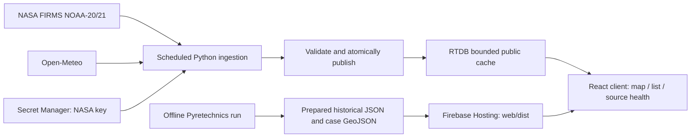

# ApexFire website build specification

Prepared 14 November 2026. **Recommendation for Claude's implementation, not an existing application or a claim of scientific validation.** The authoritative goals, status and ordered roadmap live in PROJECT.md (local-only); start a build with CLAUDE_HANDOFF.md (local-only). Component evidence remains in [readiness](readiness/README.md), rather than being duplicated here.

## 1. Product and first-release boundary

ApexFire helps people explore North Macedonia's satellite-observed fire activity over time, understand selected real incidents, inspect current detections and weather, and see how an explicitly experimental spread model works. The first audience is the Space Apps judges and interested public; operational emergency response is a future use case requiring validation and an operating partner.

The first release must answer five questions:

1. Where and when did satellites detect thermal activity, and which sensor reported it?
2. What seasonal patterns are visible within a sensor's available record, and where are the gaps?
3. What do dated observations actually show about the Brvenica 2017 and Mariovo 2024 cases?
4. What current satellite/weather information can the connected system retrieve, and how old is it?
5. What does the real Mariovo model scenario produce under its stated assumptions?

**Two delivery states share the same interface:**

- **Data-backed demo:** historical partitions, eight Brvenica observations, Mariovo evidence, the executed spread scenario and clearly dated FIRMS/weather samples. This can run without cloud provisioning. A sample is always labeled “Saved sample — 14 November 2026,” never live.
- **Connected monitoring release:** trusted scheduled ingestion, shared cache, source-health states and actual client updates. This is the intended monitoring capability; it is satisfied only after the end-to-end refresh checks pass. If its infrastructure is blocked, ship the useful demo and keep this requirement pending.

Cross-sensor normalization is required for the demo. **Validated statistical harmonization remains a separate scientific requirement**, especially important to the challenge; separate-sensor charts alone do not satisfy it. Do not claim that the challenge is fully solved before evaluating the method.

## 2. Recommended stack

| Layer | Recommendation | Why it earns its place / exit path |
| --- | --- | --- |
| Browser app | React + TypeScript + Vite; npm lockfile | A map-centered client app with static build output. No server rendering requirement has been established. Portable to any static host. |
| Styling | CSS custom properties and plain CSS; system font stack | Enough for a coherent custom interface without a component framework. Tailwind is optional only if Claude already uses it efficiently; do not introduce both styling systems without a reason. Check Macedonian glyphs. |
| Navigation/state | Small route layer; URL search parameters for view/date/sensor/selection; React state | Deep links and reproducible views. No global state package needed initially. |
| Map | MapLibre GL JS, directly integrated in a small React map component | Vector basemap, GeoJSON points/polygons and efficient layer styling. Use the official current Vite worker setup. Leaflet is a fallback if an actual target-device problem changes the decision. |
| Basemap | OpenFreeMap style using OSM data; configurable style URL | No proprietary map SDK dependency. Keep required OpenFreeMap/OpenMapTiles/OSM attribution. External tile requests reveal IP/viewed area; no automatic precise geolocation. Public tile availability is a dependency, not an SLA. |
| Charts | Accessible SVG/HTML calendar and simple bars first; Apache ECharts only if richer linked charts justify it | Do not add a chart library just to draw a calendar. Charts need equivalent numeric summaries. |
| Historical processing | Existing Python tools; standard-library streaming for the 47,046-row MK subset | Reuse inspected files and schemas. DuckDB is an optional later analytical tool for global processing, not a browser dependency or an MVP database. |
| Spatial/model preparation | Existing Python geospatial environment; isolated pinned Pyretechnics environment | Reuse verified exports. Browser reads WGS84 GeoJSON and prepared images, not native rasters or the engine. |
| Static hosting | Existing Firebase Hosting registration, explicit `web/dist` output | Uses the user's existing project. The same build directory can move to another static host. Configure SPA fallback without masking missing data files as HTML. |
| Connected ingestion | Python Cloud Functions for Firebase, scheduled through Cloud Scheduler | Reuse/extract existing FIRMS/weather request and validation logic. One regional pipeline, not one NASA call per visitor. No need for a separate FastAPI service or manually managed Cloud Run service for this slice. |
| Shared live cache | Firebase Realtime Database, bounded public read-only snapshots | Delivers actual newly written cache data to clients. Admin/service identity writes; browser cannot write. Use RTDB alone for this cache, not RTDB plus Firestore. JSON export makes migration straightforward. |
| Secrets/operations | Secret Manager for NASA key; IAM/service identity; bounded logs and scheduler | Hosted ingestion must not read a laptop credential file. Omit NASA Earthdata bearer from deployed services until a required protected product is implemented. |
| Verification | TypeScript/build checks, small behavioral unit tests, Playwright browser checks and Firebase emulator rules tests when connected | Test the actual data boundaries and essential journeys, rather than implementation details. |

**Fit scores are recommendations, not benchmarks.** For the next-day prototype, React/Vite is **9/10**, a server-rendered full-stack framework **6/10**, and a static hand-written JS app **7/10**: judged on integration effort, explicit contracts, portability and sufficient UI structure. Python scheduled functions plus RTDB are **8/10** for the connected slice because they fit existing Python ingestion and the user's Firebase setup; static snapshots are **9/10** for dependable demonstration but **2/10** for ongoing monitoring. A PostGIS/BigQuery/always-on API stack is **4/10** at the current MK scale because it adds deployment work without a demonstrated query need.

No analytics, authentication, AI API, paid map service, PostGIS, Redis, Earth Engine or global warehouse is required for the first release. The user's Analytics SDK sample measures website use; it does not supply fire data. Accounts become justified by synchronized personal subscriptions or operational collaboration, not basic viewing.

Verify and pin compatible current dependencies when creating the app; keep a lockfile. Do not copy a remembered version number. Official references checked 14 November 2026: [Vite](https://vite.dev/guide/), [MapLibre](https://maplibre.org/projects/gl-js/), [OpenFreeMap integration](https://openfreemap.org/quick_start/), [Firebase Hosting](https://firebase.google.com/docs/hosting/quickstart), [scheduled functions, including Python](https://firebase.google.com/docs/functions/schedule-functions), [runtime configuration](https://firebase.google.com/docs/functions/manage-functions), [RTDB listeners](https://firebase.google.com/docs/database/web/read-and-write). Scheduling is billed; concurrency/overlap must be handled. Do not infer that the user's reported credits cover this Firebase project.

## 3. Website structure and essential journeys

Use a compact application shell, rather than a separate elaborate landing site. Header: approved icon/FireWatch, Explore, Fire Stories, Spread Lab, Data & Methods, About. The first screen explains the value in one sentence and opens useful data. Keep large numbers subordinate to their definition and time range.

| Route / screen | Content and controls | Completion check |
| --- | --- | --- |
| `/` → `/explore` | North Macedonia map; History / Current tabs; short explanation; source status; map/list switch | A new visitor can open useful data without signing in or dismissing a tour. |
| `/explore?mode=history` | Year/month/day calendar; sensor-specific activity series; date range, sensor and native confidence filters; linked map/list; local place search; selected detection detail; CSV/GeoJSON export | Filters change map, list, counts and export consistently. Coverage gaps remain visible. URLs restore/share state. |
| `/explore?mode=current` | NOAA-20/21 latest observations; rolling-window list; weather/wind; original EFFIS seasonal mapped-area/event panel; feed health; official CUK/MKFFIS links; optional CAMS AQ | Valid empty response, provider error, old observations, failed refresh and offline state are distinct. Seasonal mapped events and heat detections never share an unlabeled “fires” count. |
| `/stories` | Two case cards with evidence type, location, dates and available observations | Brvenica opens observation replay; Mariovo opens the evidence study. Šerta is omitted until analyzed. |
| `/stories/brvenica-2017` | Eight acquired burned-area frames; date-step playback; missing-date track; quality, source area and interval-average growth; official EFFIS comparison | Playback skips to real acquisitions without fabricated intermediate fronts. Missing observations and source disagreement remain visible. |
| `/stories/mariovo-2024` | Incident extent reference, dated HLS/MODIS evidence, terrain/cover context, sourced findings and limitations; link to separate model experiment | The reference perimeter and approximately 3,971 ha MODIS-derived overlap are not presented as agreeing measurements of final area. |
| `/spread-lab` | Executed Mariovo scenario; assumed ignition; inputs/units; 30/60/120/180 minute stepper; 2/4/11/17 modeled ha; clear experimental label; downloadable scenario | Map and time/area table match the actual saved GeoJSON. No control suggests a new run without executing one. |
| `/data-methods` | Source catalog, coverage matrix, processing/quality policy, normalization vs harmonization, model assumptions, provider health, attribution/licenses, downloads | A reader can trace a displayed number to a dataset and transformation, and find material limitations from the relevant view. |
| `/about` | Purpose/challenge, intended audience, current vs planned capabilities, privacy, project contact only if supplied | No invented team members, institutional endorsements, contact details or operational claims. |

### History and sensor comparison

Initial default: a complete available recent year such as 2025, North Macedonia, separate MODIS / NOAA-20 / S-NPP series. Use UTC calendar buckets for reproducible science; offer clearly labeled Europe/Skopje times in details. Calendar tooltips/buttons include date, count, selected sensor and coverage status.

Display **detections** or **days with detections**, never unique fires. A day with zero rows means “No detections recorded in this file,” not confirmed no fire. A missing batch has a distinct appearance. Observation opportunity/cloud exposure is unknown even within available files. Do not combine differing confidence scales into a percent slider. Preserve type/version and explain any exclusion policy, with included/excluded counts. Initially avoid unsupported filtering that assumes every type label is equally reliable.

MODIS 2013 is absent; NOAA-20 starts partway through 2018; S-NPP is local only for 2024–2025. Do not silently fill these periods or draw a single continuous comparable trend. Harmonization research uses MODIS/NOAA-20 overlap 2018–2025, with partial 2018 handled explicitly and held-out evaluation; details remain a research result to produce, not fabricated app values.

### Current observations and weather

Start with a bounded MK + neighboring-border rectangle, labeled as such. The tested bbox includes neighboring countries. Do not label every returned point as Macedonian. A CC BY 4.0 geoBoundaries national polygon is now downloaded for reproducible country masking, alongside eight regional features. The represented boundary is **2016**, not current legal border authority; label the reference and define boundary-point handling. Do not call ADM1 municipalities or assume GeoNames administrative codes join directly. The older coarse Natural Earth outline remains research context.

Show satellite acquisition time, last successful retrieval, last attempted refresh and per-provider status separately. Observation age is not measured ingestion latency. A successful empty response is “No detections returned for this window”; a failed request must retain its error state and last successful snapshot. Old observations do not alone prove the feed is broken.

Weather: temperature °C, RH %, hourly precipitation mm, sustained 10 m wind m/s and direction FROM degrees; gusts separate. A UI may display km/h with a tested conversion while retaining m/s in its contract. Show selected point versus returned model grid point, forecast validity, model requested and unknown run time where absent. Cache named areas initially (Skopje/Mariovo); arbitrary map-click forecasts should wait until bounded caching/rate controls are implemented. A wind arrow is environmental context, not a spread prediction.

Original-provider EFFIS seasonal JSON is now verified: latest nonnull 11 November 2026 cumulative row is **25,323 ha / 69 mapped events**, agreeing with the annual endpoint. Keep source product, cutoff, units and mapped-event definition visible. Future weeks are null, not zero; current year is partial. Its historical reference metadata starts at 2006, while WildfireSignal displays different totals/baseline. Do not copy that site's values, create ratios from incompatible baselines, sum different burned-area products or interpret mapped events as confirmed active incidents. EFFIS can include smaller-than-30-ha mapping since Sentinel-2 integration; a universal 30-ha cutoff is inaccurate.

Optional air-quality card: use the tested explicit CAMS Europe response through Open-Meteo; PM2.5/PM10/CO are μg/m³, European AQI is **EAQI**, 48 hourly samples, about 11 km modeled context. Preserve time/grid/domain and credit CAMS ENSEMBLE + Open-Meteo. No claim that a particular fire caused the pollution. Empty/failed AQ is independent of successful fire data. MET Norway has a tested 91-step point forecast and source/cache metadata; keep it as an explicit fallback/comparison with **at least three hours between identical MK requests**, never a silent mixed-provider forecast.

For place search, preprocess GeoNames MK's **2,773 populated places** from the 25,482-record country download; retain IDs, primary/alternate names, coordinates, class and attribution. Use a compact local subset for keyboard-accessible search, including Macedonian/Latin alternatives where available. No per-keystroke external geocoding. Selecting a place moves the map; it does not confirm an incident name or people exposed. Optional local saved places can follow; synchronized subscriptions are a separate requirement.

### Case stories and Spread Lab

Brvenica is an **observed satellite-derived progression**, July–August 2017: eight burned-area geometries, fifteen missing observations, quality flags and source dates. The pre-fire reference is neither ignition nor a burned frame. Planet-derived final area 5,363.15 ha and official EFFIS 5,197 ha differ; official dates also differ. Preserve both claims. Frames are not strictly nested; do not force a cumulative union. Timezone UTC is an explicitly recorded convention, not supplied certainty.

Mariovo's **historical case** and **model experiment** are separate entities. The experimental run uses 100 m EPSG:32634 cells, coarse older EFFIS fuels, NASADEM and three hourly historical-forecast wind values for 2 September 2024. Ignition at 12:00 UTC and moisture are hypothetical; canopy is zero, making this surface-only. The precomputed final 17 ha result supersedes an earlier 25 ha run. It does not explain the approximately 10,265 ha source-reported case perimeter. A new original EFFIS 2024 regional query found no geometry intersecting that reference. Retain it as **unconfirmed secondary geometry**, with conditional overlap findings; do not present verified incident extent or use it as model ground truth. Brvenica remains the stronger confirmed replay.

The first Spread Lab exposes playback and input inspection. Changing wind/moisture/ignition requires a real newly executed model result, input hashes and updated assumptions. A cosmetic polygon stretch, wind cone, random animation or interpolated edge is unacceptable. Interactive engine service, extra genuinely executed scenarios and uncertainty ensembles follow the baseline release. Do not put a compiled model or full raster stack in the browser.

A dated GIBS MODIS Terra true-color overlay is now tested for Mariovo (2 September 2024, EPSG:3857, `GoogleMapsCompatible_Level9`, JPEG, max zoom 9). Use the actual capability-derived tile template, explicit date, opacity/toggle and blank/cloud/failure state. It is a browse visualization, not the numeric HLS source or measured burn extent. Preserve existing HLS evidence first. Source-backed case pages can later use browser print for a concise dossier; no paid PDF service is needed.

### Alerts and future feature boundaries

For the connected first monitoring slice, implement an **in-site new-detection indicator** against a successful refresh baseline, deduplicated by source observation identity. Reconnection/initial subscription must not alert every historical item. It reports new records, not new confirmed incidents or emergency warnings. No browser permission needed for this in-site feature.

Push/email/SMS alerts, user-saved subscriptions, official incident alerts, smoke/air-quality forecasts, people/roads/protected-area exposure totals, fire-danger indices, global coverage and AI learning are roadmap goals. They require their own sources, delivery tests or model evaluation. Do not show active buttons or fabricated values for them. Basemap roads are context, not an exposure analysis.

The new CAMS concentration sample supports the optional AQ card above; wildfire-attributed smoke/plumes remain later. MKFFIS now has actual dated FWI/vegetation-dryness maps and a numeric FWI pixel proof, but public reuse rights, issue/valid metadata and secure distribution remain unresolved. Link the official portal; do not ingest/rehost its plain-HTTP service or convert VDM classes into measured fuel moisture. EONET provides four curated 2024 regional source references, some repeating GDACS already held; it is not independent corroboration or a complete national incident feed. GHSL/Overture, WDPA/GBIF/IUCN, news and aircraft need the acquisition/rights checks in the new source report before any impact claim.

## 4. Data contracts and publication boundary

Keep four distinct data classes throughout types, legends and exports: `satellite_detection`, `observed_burned_area`, `incident_reference`, `experimental_spread_scenario`. Weather is modeled environmental forcing with its own provenance. Do not use a generic `Fire` object that silently promotes a detection to an incident.

### Compact historical export — new work

Read the inventory to select the **35 original North Macedonia CSVs**; do not recursively treat all new `Data/**/*.csv` as sensor input. Preserve originals. Export small sensor/year JSON partitions plus a catalog under a prepared publication directory. For 47,046 total records, standard-library streaming is sufficient. Load only the selected periods, not all global records. No frontend-ready historical partition exists yet.

Each exported observation retains a deterministic source-record ID; source family/product/satellite/instrument; ISO UTC acquisition; longitude/latitude; original confidence with its scale; FRP MW; scan/track and original units; type, processing version and source file reference. Preserve additional fields in a documented raw/optional mapping where useful. Identity must not deduplicate different sensors into one incident. A normalized field missing from source is null with a reason, not invented. The catalog records source files/hashes, transformation version, record counts, coverage/gaps, quality policy, license/credit and export time. Keep source filename labels such as `Macedonia_Former_Yugoslav_Republic_of` while displaying North Macedonia.

Publication paths are recommendations to establish during build, not existing files:

```text
web/                         React app, lockfile, local build scripts
  public/data/               generated, sanitized, explicitly selected JSON/GeoJSON/images
  src/                       screens, shared map, data loaders/types, styles
  dist/                      only this directory is Firebase Hosting public output
functions/                   connected ingestion only; separately packaged Python source
tools/                       existing audit/acquisition/model tools; add export here
tests/                       existing scientific/input checks; keep their ownership
Data/                        private local source/preparation store, never web public root
docs/                        specification, evidence and source records
```

Do not export every manifest indiscriminately. Make a public catalog that contains useful provenance, not private Cloud project metadata, credential-file paths, signed URLs, request headers or research captures. Copy only approved derived outputs needed by the site. Never upload `Data/`, `.venv/`, private keys, research archives or the workspace root. Git exclusion and Firebase Hosting exclusion are separate controls.

### Existing compact input contracts

| Input | Contract to preserve |
| --- | --- |
| `Data/readiness/firms/viirs_noaa{20,21}_nrt.json` | Array objects with `source`, `observed_utc`, latitude, longitude, `frp_mw`, `raw`. Manifest holds bbox/retrieval/validation. Retain native confidence and SP/NRT distinction. |
| `Data/readiness/weather/` | Raw API responses plus metadata and manifest. Hourly CSV schema/units/time semantics are in the weather report. Choose/test a supported current model before ongoing integration. |
| `Data/readiness/progression-2017/observed-perimeters.geojson` | Eight WGS84 features; actual acquisition UTC/convention, original acquisition/area/quality, geometry-derived area. Separate missing-observation and pre-fire files. |
| `Data/readiness/spread-scenario/mariovo-perimeters.geojson` | Four WGS84 features: `elapsed_minutes`, `valid_time_utc`, `burned_area_ha`, `kind`, `model`, `calibrated=false`. Keep manifest/license alongside public explanatory metadata. |
| `docs/case-studies/mariovo-2024/` | Reviewed narrative, metrics and overview image; derive any map layers from the case manifest with the same source caveats. |
| `Data/readiness/additional-sources/manifest.json` | Sixteen verified original-provider artifacts, including original 2024/recent-week EFFIS perimeter queries; exact current assets/requests/hashes in manifest. Read [additional-source contracts](readiness/additional-sources.md). Prepare only selected public derivatives; never export research/Cloud metadata wholesale. |

Additional types belong beside the existing source classes: `seasonal_burned_area_statistics`, `modeled_air_quality`, `reference_boundary`, `gazetteer_place` and `imagery_context`. Preserve a product-specific cutoff/baseline and original provider fields. A 52-row seasonal series can include future-null values; a 91-step MET forecast is not an hourly series. EFFIS/GWIS mapped geometry must keep its own method/source class: automatic VIIRS hotspot-derived polygons are not equivalent to MODIS/Sentinel-2 image-classified burned scars or an official incident perimeter.

Validate fetches at runtime: expected schema/version, finite coordinates/values, legal timestamps, array lengths, enums and correct content type. Reject HTML error bodies or empty malformed files as failures. HTTP 200 alone is insufficient. Render loading/error/empty/stale states explicitly; preserve a previously valid dataset if a refresh fails.

## 5. Connected architecture and cost controls



**Recommended project:** use `firewatch-ff023` for Hosting and its eventual connected cache/functions, avoiding cross-project IAM for this small product. This is a recommendation; current billing is disabled. The separate research GCP project's active billing and reported $300 credit do not establish funding here. Before provisioning, record the selected project, EU region compatible with Functions/RTDB, billing arrangement, budget threshold and who operates the scheduler. Do not create duplicate projects or link billing by assumption. No cloud changes were made for this plan.

Proposed cadence: FIRMS every 10 minutes, named-area weather hourly. These are cache policy choices, not satellite revisit promises. Fetch each NOAA product once per area/window, not per user. Keep one bounded 24-hour detection window; when requesting calendar-day API ranges, cover the midnight rollover and clip by actual UTC acquisition. Check actual FIRMS/Open-Meteo account limits before enabling the cadence. Example request budget for two FIRMS products is about 288 requests/day, before retries; provider quota accounting may differ.

For added optional sources, retain separate provider clocks: EFFIS season data daily cache check for weekly publication, CAMS daily model publication with hourly valid values, MET minimum three-hour identical-query interval plus cache headers. Download boundaries/gazetteer as versioned assets, not on every app load. GIBS is a dated tile dependency. Existing NASA keys do not grant access to restricted WDPA/IUCN/ReliefWeb products; do not create unnecessary account workflows or query competitor private APIs.

Store source-specific metadata with `last_attempt_utc`, `last_success_utc`, `latest_observation_utc`, requested bbox/window, valid count, sanitized error/status and export/schema version. Use a transaction/lock or equivalent to prevent overlapping runs publishing older data over newer. Validate whole snapshots before atomic publication; handle bounded retries, duplicate delivery and partial provider failure without dropping a healthy source. Never reset success time on failed fetch or on a client opening the page.

Recommended **cache refresh** policy: FIRMS stale after 30 minutes without a successful refresh, hourly weather stale after 2 hours; label these as application thresholds. Acquisition/forecast age remains separate. Expired-window records disappear only as a successful new window supersedes them; do not interpret this as an extinguished fire. If scheduling stops, retain the last snapshot visibly stale. In demo mode no automatic updater exists: state that directly.

RTDB: deny client writes everywhere; deny reads by default; permit reads only for the explicitly public bounded cache. Service identity writes through Admin SDK/IAM. Test rules in emulator. Subscribe only to the necessary subtree and unsubscribe on unmount. No root listener, unbounded history replication or secrets in the public tree. Limit instances, execution timeout and output size; no warm minimum instances for this workload. Budget alerts are notifications, not spending caps; record how to disable the schedule and export the last cache. Cloud Run underlies modern functions; there is no need to manage a second duplicate service.

Keep ingestion callable locally with the same validators for reproducibility. The existing CLI files must not be copied blindly into a function that includes laptop paths or a whole project archive. Extract a small shared module if necessary and retain parser tests. Model execution stays offline in its isolated environment until an actual interactive run requirement warrants separate compute.

The trust boundary is the validated server cache: public clients read scientific data and cannot submit authoritative observations. The small prototype threat model is:

| Asset / plausible failure | Likelihood and impact | Control to verify |
| --- | --- | --- |
| NASA credentials accidentally enter a build/log | Plausible during packaging; high impact through key theft/quota abuse | Explicit public-file allowlist, trusted secrets, sanitized logs and bundle inspection. Rotate/revoke a credential if exposed; track expiry before enabling scheduled access. |
| A public client alters observations or floods reads | Write attempts plausible; corrupted public evidence or cost growth | Deny client writes, bounded read paths/payloads, quotas/monitoring and a tested scheduler stop procedure. |
| An upstream error or old snapshot appears current | Expected during provider/network failure; materially misleading display | Validate complete responses, separate acquisition/success/attempt times, preserve last valid cache with visible stale/error state. |

No personal data or account is needed for core viewing. Keep any last-seen baseline locally and resettable; retain only the bounded public cache in RTDB, with selected historical exports on Hosting. No user movement history or automatic geolocation. Tile providers receive ordinary network requests; expose that dependency in the privacy text. Add retention/export/deletion rules before introducing saved subscriptions or contact information. These are requirements, not a claim that an unbuilt system has passed security verification.

## 6. Visual direction, accessibility and behavior

Use the approved `logo/apexfire-icon.svg` in compact navigation and the wordmark asset where it fits. Orange **#FF6A00** and dark **#0C0D0A** anchor the identity. Recommended appearance: a restrained dark map workspace with readable light or dark panels chosen by contrast testing; orange for selected/action states, separate distinguishable sensor colors, dashed outlines plus labels for modeled output. This is a direction, not a request to copy Firemap or another product's brand. No decorative flames over data, automatic fly-throughs or heavy background effects.

Define small CSS token sets for semantic colors, spacing, type, radii, focus, overlay levels and reduced-motion durations. Use actual content early. No large dashboard cards with undefined statistics. Keep methods near consequential numbers, not only in a footer disclaimer.

Desktop: compact filters/calendar rail, main map, on-demand detail panel. Mobile: map/list toggle and a single accessible detail sheet; filters open as a labeled panel, not three simultaneous overlays. Preserve source attribution and visible time/status at narrow widths. Test 390 px mobile and typical laptop layouts, keyboard, touch, 200% zoom/reflow and slow/error responses. Check iPhone Safari/WebGL directly if available; desktop resizing alone does not prove it.

Target WCAG 2.2 AA: semantic navigation/headings, labeled controls, visible focus, keyboard calendar/time controls, text alternatives for legends/charts, sufficient contrast and no color-only quality/status distinctions. Use approximately 44 px touch targets for main actions. Map has a synchronized accessible list/details alternative; loss of WebGL must not remove all useful content. Reduce motion; playback can pause and does not advance focus unexpectedly. Announce status changes briefly without reading every point. Do not request location or notification permissions on load.

Recommended initial UI language: English for the hackathon, preserving Macedonian names and Cyrillic. This was not explicitly selected by the user; it is a deadline-saving assumption. Correct glyphs include Ѓ, Ѕ, Ј, Љ, Њ, Ќ and Џ. Use locale-aware numbers/dates and `lang="mk"` on Macedonian text. UTC is canonical; clearly label any local display conversion, including DST.

## 7. Release acceptance and review evidence

Claude should leave a build command, local run command, data-export command, test command and a small release evidence note in PROJECT.md. Record exact revision if Git exists; otherwise name the inspected working tree/build and do not invent a commit. Tests appropriate to new nontrivial logic include:

- Export counts reconcile to selected source files; leading-zero HHMM and invalid minutes; sensor confidence mapping; UTC day/DST boundaries; missing vs zero; unique source IDs without cross-sensor collapse.
- Calendar/map/list/export agree for one known period; invalid/empty source response, provider failure, stale cache, disconnected mode and failed map tiles recover without invented values.
- Brvenica has exactly eight observation frames and fifteen missing observations; final area/source disagreement retained. Spread steps yield 2/4/11/17 ha and `calibrated=false`; no observed-case claim.
- New source checks: EFFIS null future weeks and distinct area/event units; original-provider cutoff/baseline; AQ EAQI/μg units and modeled labeling; dated GIBS alignment/blank behavior; place lookup/region labels and country-mask edge handling. Missing optional layers never invalidate healthy primary data. Research-only MKFFIS artifacts must not enter public output.
- Connected slice: actual upstream refresh → validated cache → two clients update; replay does not duplicate new-record notices; failed provider does not overwrite the last valid snapshot; unauthorized client writes fail. Emulator-only success is not a deployed feed test.
- Production build, type checks, direct route refresh, mobile/keyboard journeys, attribution, network-request and bundle inspection for private credentials, public-directory allowlist and missing-data 404 behavior.

Initial performance budgets to verify, not current measurements: no global archive in browser; selected first-view data under 2 MB compressed, app JS under 500 KB gzip excluding lazily loaded map/chart chunks, and a useful map or list within 5 seconds on a documented throttled mobile test. Record tile dependency separately. If a budget fails, reduce payload/initial work before adding infrastructure.

Deployment is a separate release action. Prepare a reviewable build and explicit Firebase configuration; do not publish or push merely because local checks pass. After authorized release, verify the actual URL, deep links, source refresh and mobile behavior. Preserve last working Hosting release/cache and disable the scheduler to stop recurring ingestion; export cache JSON before changing storage architecture. A static fallback remains useful only when it is visibly dated.

Primary accessibility reference: [WCAG 2.2](https://www.w3.org/TR/WCAG22/). Scientific reproduction/limitations and third-party attribution are in the source reports linked by the handoff.
