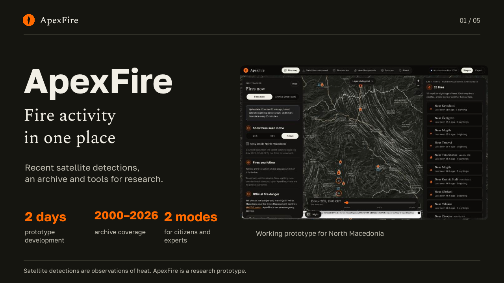
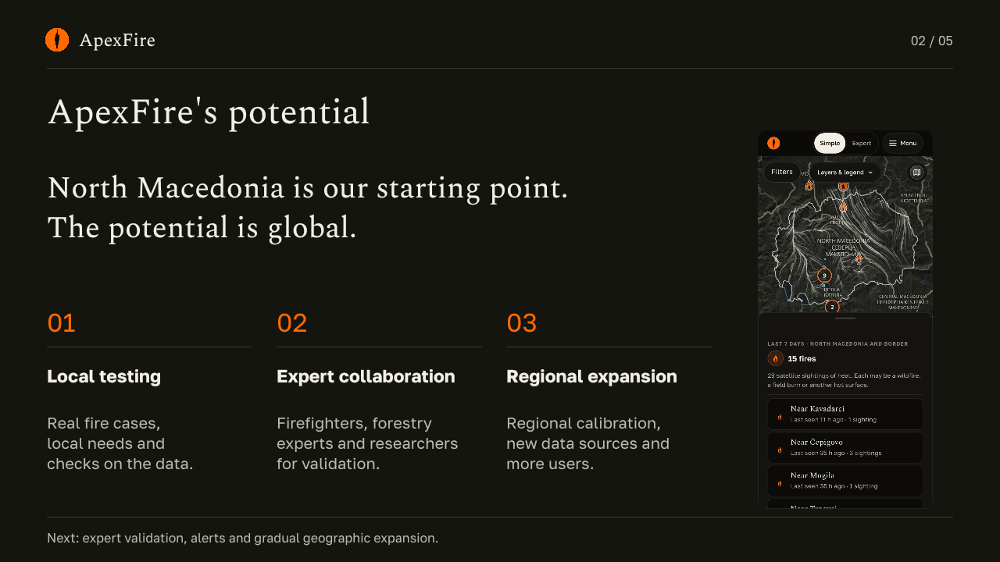
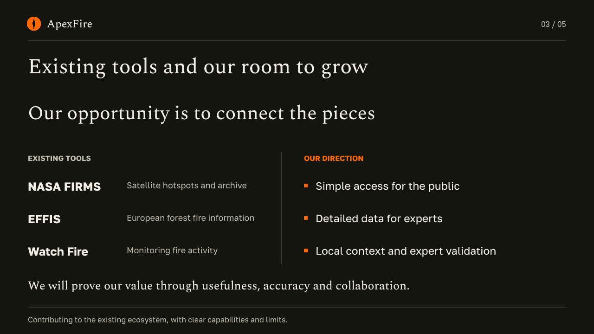
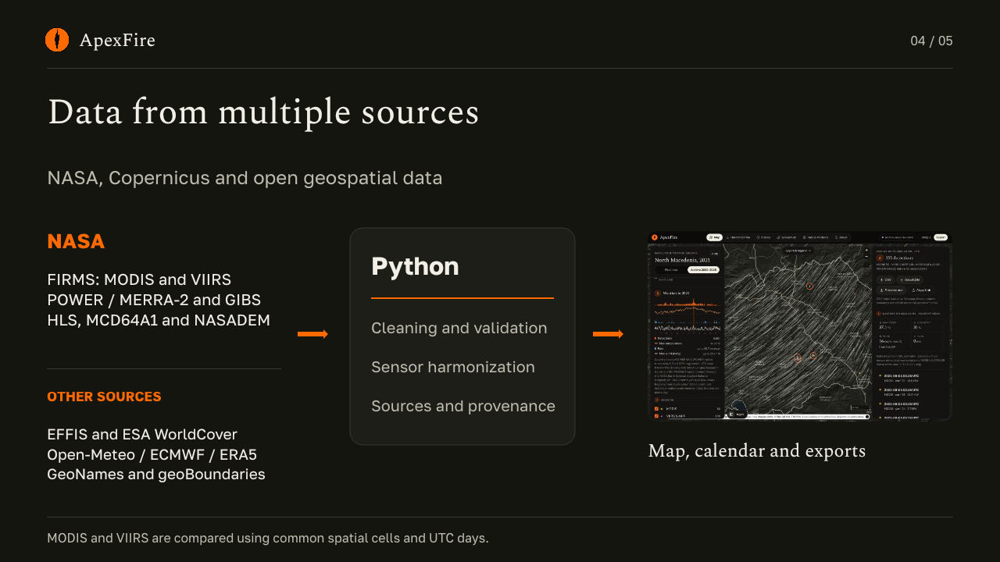
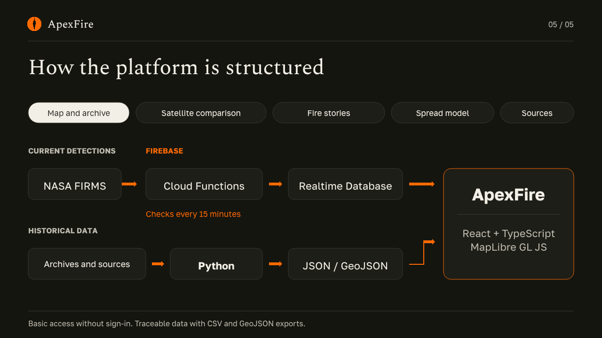

# ApexFire — Project Demo

Five-slide English presentation for the NASA Space Apps Challenge 2026.

**[View or download the presentation as a PDF](apexfire-demo-en.pdf)**

All five slides are also displayed below.

## 1. ApexFire

## 2. Potential

## 3. Existing tools and our direction

## 4. Data and processing

## 5. Platform architecture

## Sources and acknowledgements

The screenshots show our own ApexFire application. Its maps and data retain the following source credits:

- NASA [FIRMS](https://firms.modaps.eosdis.nasa.gov/), [POWER](https://power.larc.nasa.gov/), [GIBS](https://nasa-gibs.github.io/gibs-api-docs/), [HLS](https://hls.gsfc.nasa.gov/), [MODIS burned-area data](https://modis-land.gsfc.nasa.gov/burn.html) and [NASADEM](https://data.nasa.gov/dataset/nasadem-merged-dem-global-1-arc-second-v001).
- [Copernicus EFFIS](https://forest-fire.emergency.copernicus.eu/), [ESA WorldCover](https://esa-worldcover.org/), [Open-Meteo](https://open-meteo.com/), [ECMWF](https://www.ecmwf.int/), [GeoNames](https://www.geonames.org/) and [geoBoundaries](https://www.geoboundaries.org/).
- Map data © [OpenStreetMap contributors](https://www.openstreetmap.org/copyright), with [OpenFreeMap](https://openfreemap.org/) and [OpenMapTiles](https://openmaptiles.org/). Relief uses [Terrain Tiles / Mapzen / Tilezen](https://github.com/tilezen/joerd/blob/master/docs/attribution.md), including upstream SRTM, GMTED and ETOPO1 data.
- [Pyretechnics](https://github.com/pyregence/pyretechnics) for the experimental spread demonstration. [Canadian Forest Fire Weather Index System](https://cwfis.cfs.nrcan.gc.ca/background/summary/fwi) for the weather-based danger method.
- Golos Text and Spectral, distributed through [Fontsource](https://fontsource.org/) under the SIL Open Font License. Development assistance: [Claude](https://claude.ai/) and [OpenAI Codex](https://openai.com/codex/).

ApexFire is a research prototype. Satellite detections are observations of heat, not automatically confirmed wildfires. The experimental spread demonstration is not an operational forecast.
